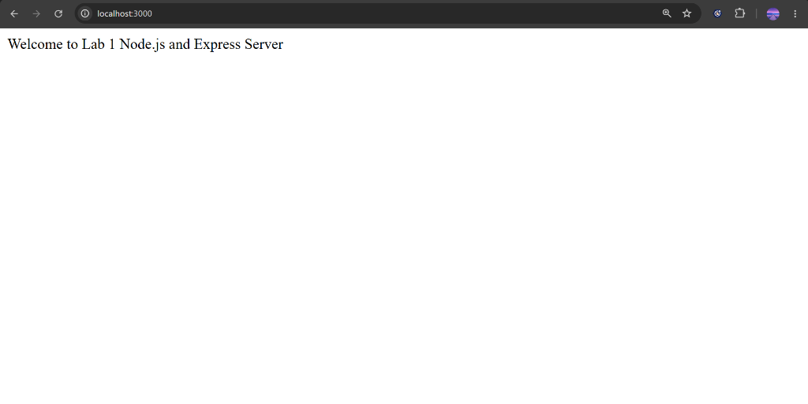
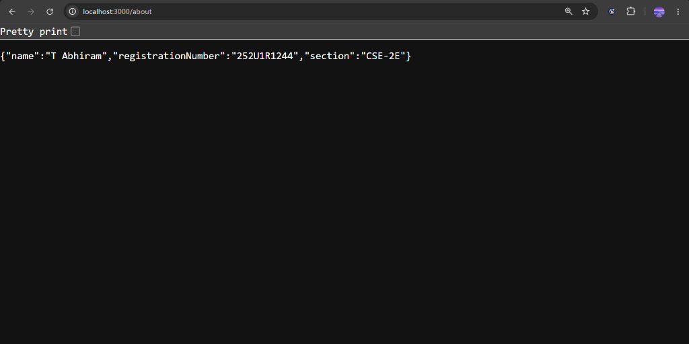
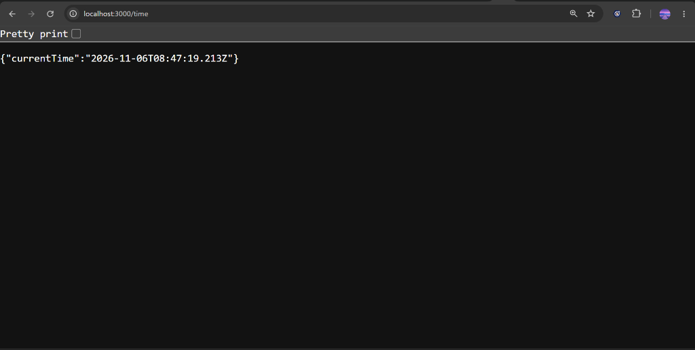
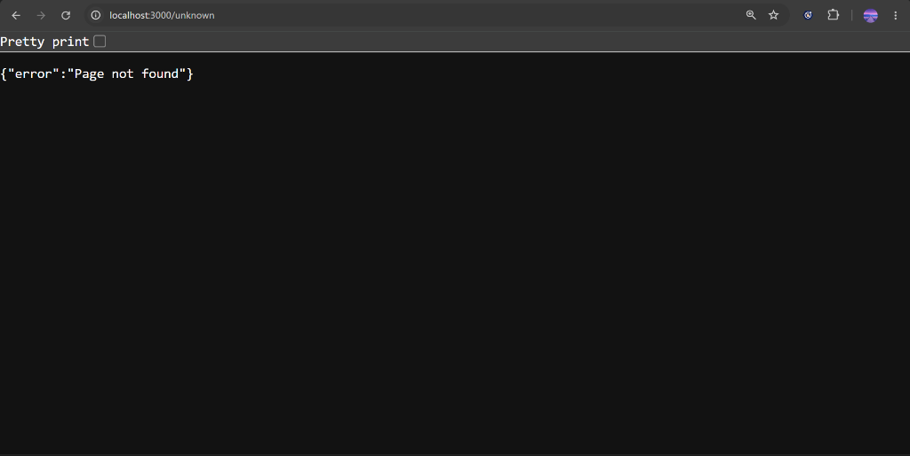

# Lab 1: Node.js and Express server

## Student Details

| Field | Details |
|---|---|
| **Student Name** | Abhiram Thunikipati |
| **Registration Number** | 252U1R1244 |
| **Section** | CSE-2E |
| **Lab Title** | Lab 1: Node.js and Express server |
| **Module** | Node.js and Express.js fundamentals |

---

## Live Link

| Deployment Platform | Live URL | Status |
|---|---|---|
| **Render** | [Add deployed URL here after deployment] | Pending Deployment |

---

## Objective
The objective of this lab is to learn the fundamentals of backend web development using Node.js and Express.js. This includes setting up a Node.js project from scratch, managing dependencies with `npm`, building a web server with Express.js, defining HTTP GET routes, handling JSON and plain text responses, implementing route-level logging, handling 404 errors for undefined routes, and preparing an application for production deployment.

---

## Technologies Used

| Technology | Purpose |
|---|---|
| **Node.js** | Server-side JavaScript runtime environment to execute code outside the browser |
| **Express.js** | Minimalist web application framework for handling HTTP routing and middleware |
| **JavaScript (CommonJS)** | Core programming language using standard `require()` syntax |
| **npm** | Package manager used to install and manage project dependencies |

---

## How to Install and Run

| Step | Action | Terminal Command | Description |
|:---:|---|---|---|
| **1** | Navigate to Project | `cd lab-01` | Enters the project root folder |
| **2** | Install Dependencies | `npm install` | Reads `package.json` and installs `express` into `node_modules` |
| **3** | Start Application | `npm start` *(or `node app.js`)* | Executes the start script defined in `package.json` |
| **4** | Open in Browser | Open `http://localhost:3000` | Verifies that the server is actively listening on port 3000 |

---

## Endpoints

| Method | Path | Description | Status Code | Expected Response |
|---|---|---|---|---|
| **GET** | `/` | Welcome message and student details as JSON | `200 OK` | `{"message":"Welcome to the Backend Development Fundamentals Lab 1!","student":"Abhiram Thunikipati","registrationNumber":"252U1R1244","lab":"Lab 1 - Node.js and Express Server"}` |
| **GET** | `/about` | Returns student details as JSON | `200 OK` | `{"name":"Abhiram Thunikipati","registrationNumber":"252U1R1244","section":"CSE-2E"}` |
| **GET** | `/time` | Returns current date and time as JSON | `200 OK` | `{"currentTime":"..."}` |
| **GET** | `/unknown` | Fallback for any undefined path | `404 Not Found` | `{"error":"Page not found"}` |

---

## Screenshots

| Endpoint | Description | Screenshot Preview |
|---|---|---|
| **GET `/`** | Home welcome route |  |
| **GET `/about`** | Student information JSON |  |
| **GET `/time`** | Current server timestamp JSON |  |
| **GET `/unknown`** | 404 Page Not Found error |  |

---

## Problems Faced and Solutions

| Problem | Cause | Solution |
|---|---|---|
| **Express not installed (`Cannot find module 'express'`)** | Missing `node_modules` or express was not installed prior to running. | Run `npm install express` inside the project directory. |
| **Port already in use (`listen EADDRINUSE: :::3000`)** | Another background process or application is already using port 3000. | Terminate the process or change the port using environment variable (e.g., `PORT=4000 npm start`). |
| **Incorrect route path (Unexpected 404)** | Typo in requested URL (e.g., requesting `/times` instead of `/time`). | Check the console request logs to verify the requested URL and match it to route definitions in `app.js`. |
| **404 handler overriding valid routes** | Defining the 404 fallback middleware before declaring the valid routes. | Always place the 404 handler (`app.use((req, res) => ...)`) at the very end of `app.js` after all valid routes. |

---

## Package.json Explanation

| Field | Description | Value in this Project |
|---|---|---|
| **`name`** | Unique package/project name | `"lab-01"` |
| **`version`** | Project version following semantic versioning (major.minor.patch) | `"1.0.0"` |
| **`description`** | Short description of what the project does | `"Lab 1: Node.js and Express server"` |
| **`main`** | Primary entry point of the server application | `"app.js"` |
| **`scripts`** | Script commands executable via `npm run <script>` or `npm start` | `"start": "node app.js"` |
| **`keywords`** | Array of search tags and descriptive keywords | `["nodejs", "express", "lab-01"]` |
| **`author`** | Developer name | `"Abhiram Thunikipati"` |
| **`license`** | Legal open-source license | `"ISC"` |
| **`dependencies`** | External production libraries installed via npm | `"express": "^5.3.0"` |

---

## Viva Questions and Answers

| # | Question | Viva Answer |
|:---:|---|---|
| **1** | **What is the difference between `package.json` and `node_modules`?** | `package.json` is a lightweight manifest file that lists project metadata and dependencies (committed to Git). `node_modules` is the directory containing the actual downloaded code for all installed packages (never committed to Git). |
| **2** | **What does `app.listen()` do?** | It binds and listens for connections on a specified port. It tells the operating system to deliver all incoming HTTP network traffic on that port to our Express application. |
| **3** | **What do `request` (`req`) and `response` (`res`) represent?** | `req` contains data about the incoming HTTP request from the client (HTTP method, URL, headers). `res` is the object used by the server to send data, headers, and HTTP status codes back to the client. |
| **4** | **What is Express.js?** | A fast, minimalist web application framework for Node.js that simplifies handling routing, middleware, request parsing, and HTTP responses. |
| **5** | **What is a route?** | An application endpoint defined by an HTTP method (GET, POST, etc.) and a path (`/`, `/about`, `/time`) paired with a callback handler function. |
| **6** | **Why do we use status code 404?** | Status 404 means "Not Found". It informs the client that the server is working properly, but the requested endpoint or resource does not exist. |
| **7** | **Why should `node_modules` not be uploaded to GitHub?** | 1. It is extremely large (hundreds of MBs). 2. It may contain OS-specific binary files. 3. It is redundant, since running `npm install` reconstructs it automatically from `package.json`. |
