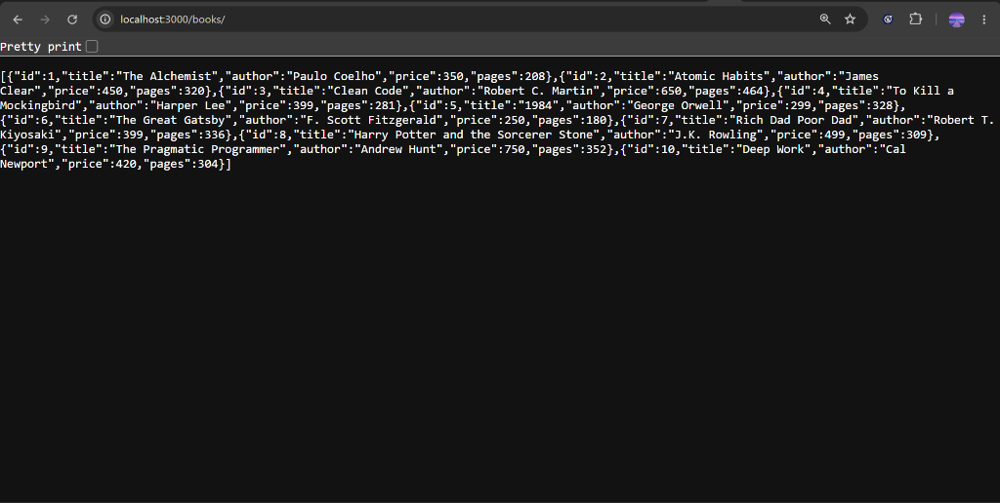
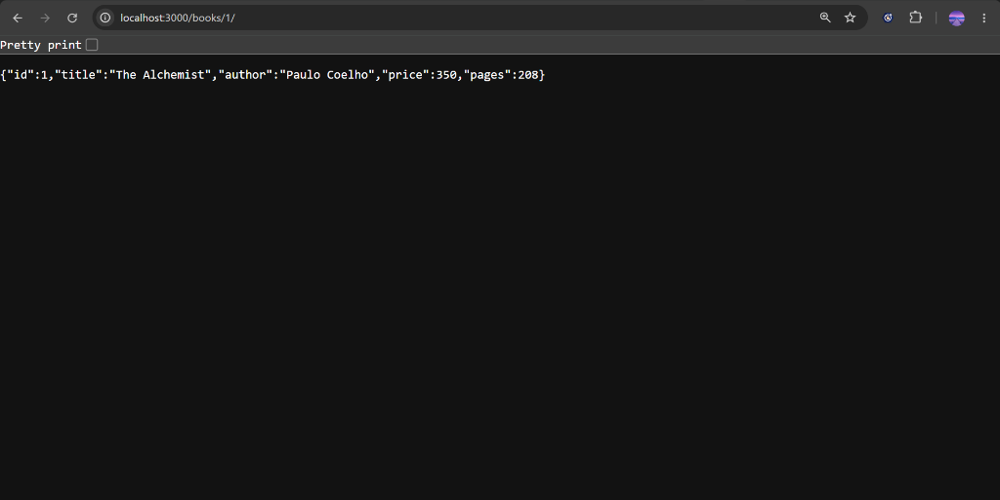
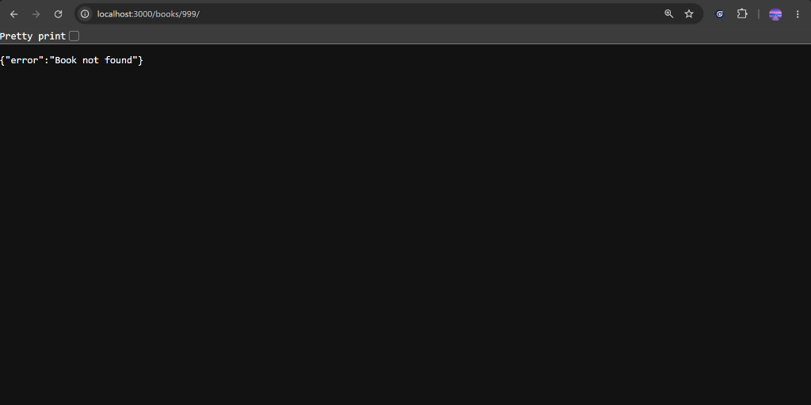

# Lab 2: SQLite database and CRUD routes

## Student Details

<table border="1" cellpadding="8" cellspacing="0" style="border-collapse: collapse; width: 100%;">
  <thead>
    <tr style="background-color: #f2f2f2;">
      <th align="left" width="30%">Field</th>
      <th align="left" width="70%">Details</th>
    </tr>
  </thead>
  <tbody>
    <tr>
      <td><b>Student Name</b></td>
      <td>Abhiram Thunikipati</td>
    </tr>
    <tr>
      <td><b>Registration Number</b></td>
      <td>252U1R1244</td>
    </tr>
    <tr>
      <td><b>Section</b></td>
      <td>CSE-2E</td>
    </tr>
    <tr>
      <td><b>Lab Title</b></td>
      <td>Lab 2: SQLite database and CRUD routes</td>
    </tr>
    <tr>
      <td><b>Module</b></td>
      <td>SQLite and relational database operations</td>
    </tr>
  </tbody>
</table>

---

## Live Link

| Deployment Platform | Live URL | Status |
|:---|:---|:---|
| **Render** | [Add deployed URL here after deployment] | Pending Deployment |

---

## Objective
The objective of this lab is to connect an Express.js web server with a SQLite relational database and implement standard CRUD (Create, Read, Update, Delete) operations through RESTful HTTP routes. This lab demonstrates asynchronous database connection handling, database schema creation, table initialization with sample data, parameterized SQL queries to prevent SQL injection vulnerabilities, proper HTTP status codes, and API testing using Postman and the SQLite CLI.

---

## Technologies Used

| Technology | Purpose |
|:---|:---|
| **Node.js** | Server-side JavaScript runtime environment |
| **Express.js** | Minimalist web framework for handling routing, requests, and responses |
| **SQLite** | Self-contained, serverless, zero-configuration relational database engine |
| **sqlite3** | Official low-level Node.js driver for SQLite |
| **sqlite** | Modern promise-based wrapper allowing `async`/`await` syntax with SQLite |
| **Nodemon** | Development tool that automatically restarts the server when files change |
| **Postman** | API development and testing tool used to send HTTP requests and verify responses |

---

## Project Structure

```text
lab-02/
│
├── app.js               # Main application entry point with DB connection and CRUD routes
├── package.json         # Project metadata, scripts, and dependencies
├── package-lock.json    # Exact dependency tree lockfile
├── .gitignore           # Ignores node_modules/ and .env (keeps database/books.db)
├── README.md            # Comprehensive lab documentation and viva guide
├── database/
│   └── books.db         # Persistent SQLite database file storing the book table
└── screenshots/
    └── .gitkeep         # Preserves screenshots directory in Git
```

---

## Installation

1. Open your terminal and navigate to the `lab-02` directory:
   ```bash
   cd lab-02
   ```

2. Install all required dependencies:
   ```bash
   npm install
   ```
   *This installs `express`, `sqlite`, `sqlite3`, and `nodemon` into `node_modules`.*

---

## Run the Project

| Environment | Terminal Command | Description |
|:---|:---|:---|
| **Development** | `npm run dev` | Runs the server using **Nodemon** (auto-reloads on file changes) |
| **Production / Local** | `npm start` *(or `node app.js`)* | Runs the server using standard **Node.js** |

Once started, the server listens on:
```text
http://localhost:3000
```

---

## Database

The project stores its data in a local SQLite database file located at `database/books.db`.

### `book` Table Schema

| Column | Type | Constraints | Description |
|:---|:---|:---|:---|
| `id` | `INTEGER` | `PRIMARY KEY AUTOINCREMENT` | Unique identifier for each book |
| `title` | `TEXT` | `NOT NULL` | Title of the book |
| `author` | `TEXT` | `NOT NULL` | Author of the book |
| `price` | `INTEGER` | `NOT NULL` | Price of the book |
| `pages` | `INTEGER` | `NOT NULL` | Number of pages in the book |

The database is automatically created and seeded with **10 realistic sample books** (e.g., *The Alchemist*, *Atomic Habits*, *Clean Code*, etc.) upon initial startup.

---

## Endpoints

| Method | Path | Description | Success Status | Error Status | Expected Response |
|:---:|:---|:---|:---:|:---:|:---|
| **GET** | `/books/` | Retrieve all books | `200 OK` | `500` | Array of all book objects |
| **GET** | `/books/:bookId/` | Retrieve a single book by ID | `200 OK` | `404 Not Found` | Single book object or error message |
| **POST** | `/books/` | Add a new book to the database | `201 Created` | `400 Bad Request` | `{"message": "Book added successfully", "bookId": 11}` |
| **PUT** | `/books/:bookId/` | Update an existing book by ID | `200 OK` | `404 Not Found` | `{"message": "Book updated successfully"}` |
| **DELETE** | `/books/:bookId/` | Remove a book by ID | `200 OK` | `404 Not Found` | `{"message": "Book deleted successfully"}` |

### 404 Not Found Case:
When requesting, updating, or deleting a book with a non-existent `bookId` (e.g., `/books/999/`), the server returns HTTP **404**:
```json
{
  "error": "Book not found"
}
```

---

## Postman Testing

All five routes and edge cases are tested in Postman using the following request formats:

1. **GET All Books:**
   - **Method:** `GET`
   - **URL:** `http://localhost:3000/books/`
   - **Status:** `200 OK`

2. **GET One Book:**
   - **Method:** `GET`
   - **URL:** `http://localhost:3000/books/1/`
   - **Status:** `200 OK`

3. **POST Add Book:**
   - **Method:** `POST`
   - **URL:** `http://localhost:3000/books/`
   - **Headers:** `Content-Type: application/json`
   - **Body (raw JSON):**
     ```json
     {
       "title": "Introduction to Algorithms",
       "author": "Thomas H. Cormen",
       "price": 899,
       "pages": 1312
     }
     ```
   - **Status:** `201 Created`

4. **PUT Update Book:**
   - **Method:** `PUT`
   - **URL:** `http://localhost:3000/books/1/`
   - **Headers:** `Content-Type: application/json`
   - **Body (raw JSON):**
     ```json
     {
       "title": "The Alchemist (Collector's Edition)",
       "author": "Paulo Coelho",
       "price": 499,
       "pages": 220
     }
     ```
   - **Status:** `200 OK`

5. **DELETE Book:**
   - **Method:** `DELETE`
   - **URL:** `http://localhost:3000/books/1/`
   - **Status:** `200 OK`

6. **Error Case (Book Not Found):**
   - **Method:** `GET` (or `PUT`/`DELETE`)
   - **URL:** `http://localhost:3000/books/999/`
   - **Status:** `404 Not Found`

### Screenshot Previews








---

## SQLite CLI Testing

You can inspect and verify changes directly inside the SQLite database using the command line:

1. Open the database in the terminal:
   ```bash
   sqlite3 database/books.db
   ```

2. View all tables:
   ```sql
   .tables
   ```

3. Query all rows in formatted mode:
   ```sql
   .mode column
   .headers on
   SELECT * FROM book;
   ```

4. Exit the SQLite prompt:
   ```sql
   .exit
   ```

### Verifying Route Changes:
- **After POST:** Run `SELECT * FROM book;` to see the new record inserted at the bottom.
- **After PUT:** Run `SELECT * FROM book WHERE id = 1;` to see that title/price/author were updated.
- **After DELETE:** Run `SELECT * FROM book WHERE id = 1;` to confirm no row is returned.

---

## Parameterized Queries and SQL Injection

### Why use `?` placeholders?
In our application, every query that accepts user input uses `?` placeholders:
```javascript
// SAFE: Parameterized Query
const query = `SELECT * FROM book WHERE id = ?;`;
await db.get(query, [bookId]);
```

### Why string concatenation is dangerous:
If we wrote queries like:
```javascript
// DANGEROUS: Susceptible to SQL Injection
const query = `SELECT * FROM book WHERE id = ` + bookId;
```
A malicious user could submit `1 OR 1=1` or `1; DROP TABLE book;`, causing arbitrary unauthorized SQL statements to execute on our database.

### How `?` protects our database:
The database driver treats the values passed in parameters strictly as literal data, never as executable SQL code. Any special characters or SQL keywords inside the parameter are automatically sanitized.

---

## Problems Faced and Solutions

| Possible Problem | Root Cause | Solution |
|:---|:---|:---|
| **SQLite connection error (`SQLITE_CANTOPEN`)** | The `database/` folder did not exist or the relative path was incorrect. | Use `path.join(__dirname, 'database', 'books.db')` so the path resolves reliably regardless of where the app is launched from. |
| **Port already in use (`EADDRINUSE: :::3000`)** | Another Node.js process or previous instance is running on port 3000. | Stop the process from Task Manager / terminal, or specify a different port using `PORT=4000 npm start`. |
| **Missing Request Body (`Cannot read properties of undefined`)** | Forgot to register `app.use(express.json())` middleware. | Ensure `app.use(express.json())` is called before route definitions so JSON payloads are parsed into `req.body`. |
| **Book ID not found (Expected 404)** | Querying an ID that does not exist or was already deleted. | Check whether `book === undefined` after `db.get()`, and return status `404` with a clean JSON error. |
| **Nodemon not restarting** | Nodemon may not be watching all file extensions or file permissions issue. | Run `npx nodemon app.js` or use `npm start` directly. |

---

## Viva Questions and Answers

| # | Question | Simple Answer |
|:---:|:---|:---|
| **1** | **Why do we use `await` for database calls?** | Database operations are asynchronous because reading/writing to disk takes time. `await` pauses execution until the query completes without blocking the entire application. |
| **2** | **What is SQL injection?** | A security vulnerability where an attacker injects malicious SQL statements through user input to read, alter, or delete database data. |
| **3** | **How do placeholders (`?`) prevent SQL injection?** | Placeholders separate code from data. The database compiles the query structure first, then treats placeholder values strictly as literal values, never as executable SQL commands. |
| **4** | **When is `PUT` used instead of `POST`?** | `POST` is used to create a new resource. `PUT` is used to update or replace an existing resource at a specific identifier. |
| **5** | **What is SQLite?** | A self-contained, serverless, file-based relational database management system that stores the complete database in a single disk file. |
| **6** | **What is CRUD?** | CRUD stands for **Create** (POST), **Read** (GET), **Update** (PUT), and **Delete** (DELETE) — the four basic functions of persistent storage. |
| **7** | **What is the difference between `sqlite` and `sqlite3`?** | `sqlite3` is the core low-level C++ driver for Node.js (callback-based). `sqlite` is a higher-level wrapper that adds Promise support so we can use modern `async`/`await`. |
| **8** | **What does `req.params.bookId` mean?** | It extracts the dynamic route parameter named `:bookId` from the URL path (e.g., in `/books/5/`, `req.params.bookId` is `"5"`). |
| **9** | **Why do we use `express.json()`?** | It is built-in middleware that parses incoming requests with JSON payloads and populates `req.body` with JavaScript objects. |
| **10** | **Why does the POST route normally return 201?** | HTTP 201 stands for "Created", which indicates that the request succeeded and led to the creation of a new resource in the database. |
| **11** | **Why do we return 404 when a book does not exist?** | HTTP 404 stands for "Not Found". It explicitly signals to the client that the requested resource identifier does not exist in the database. |
| **12** | **Why should `node_modules` not be uploaded to GitHub?** | It is huge in size (hundreds of megabytes), contains platform-specific compiled binaries, and can easily be regenerated at any time by running `npm install`. |

---

## Deployment on Render

### Steps to Deploy:
1. Push your repository to GitHub.
2. Log in to [Render](https://dashboard.render.com/) and click **New +** &rarr; **Web Service**.
3. Connect your GitHub repository.
4. Set the configuration:
   - **Root Directory:** `lab-02`
   - **Build Command:** `npm install`
   - **Start Command:** `npm start`
   - **Environment:** `Node`
5. Click **Deploy Web Service**.
6. Once deployed, test all endpoints on your public Render URL:
   - `GET /books/`
   - `GET /books/1/`
   - `POST /books/`
   - `PUT /books/1/`
   - `DELETE /books/1/`

### ⚠️ Important Note on SQLite with Render Free Services (Ephemeral Filesystem)
Render Free web services run on containers with an **ephemeral filesystem**. This means:
- Any changes made to the SQLite database during runtime (such as adding, updating, or deleting books) will not be permanently preserved across server restarts, redeployments, or when the free service spins down due to inactivity.
- On each fresh start, the database resets to the committed Git state (or re-initializes with the 10 sample books).
- For the college lab requirement, the local SQLite database file `database/books.db` is maintained and committed so that sample data is always available upon launch.

